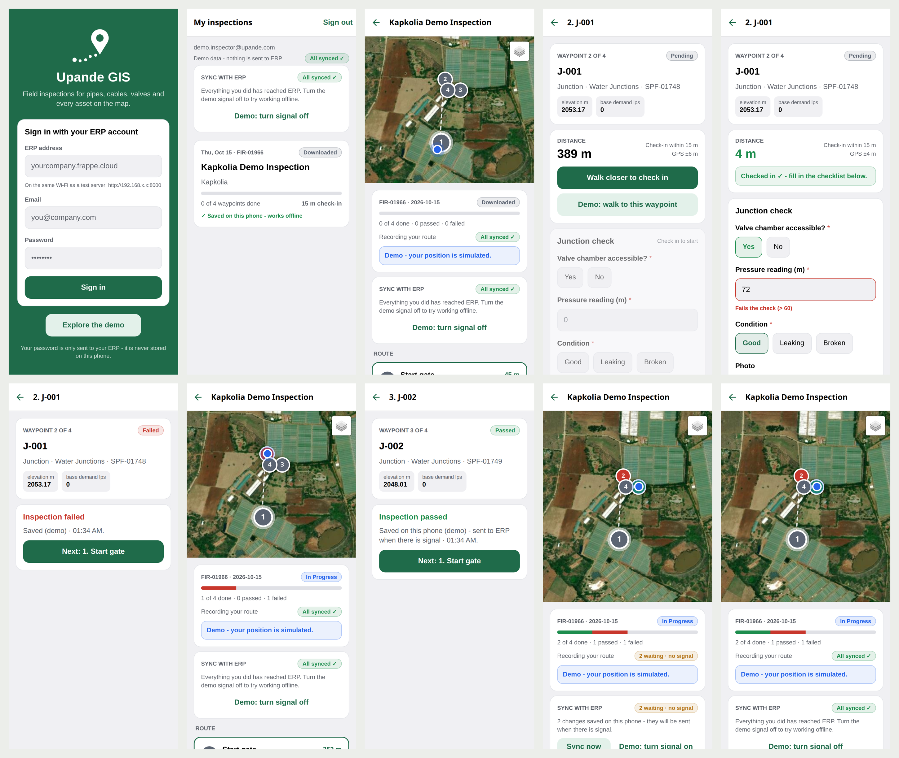

# Upande GIS

Field inspection app for Upande ERP. An inspector downloads the inspection runs assigned to them, walks the route on a satellite map, checks in at each waypoint (GPS, within the run's check-in radius), fills in the checklist (yes/no, choices, readings, text, photos, signature) and submits. Answers that break a rule (for example a pressure reading above 60 m) are marked as failing straight away. Everything works without signal and syncs to ERP when the phone is back online, and the walked route is recorded as a GPS track.

Built with Expo SDK 57 (React Native 0.86, Expo Router, TypeScript). The server side is the `upande_spatial` Frappe app (`upande_spatial.api.inspection.*`).



## Requirements

- Node.js 22 or newer (24 is used here) and npm.
- An Android or iOS phone. Install **Expo Go** from the Play Store or App Store to try the app quickly. Background GPS needs a development build (see below).
- An Upande ERP site with `upande_spatial` installed, and an account that can inspect (see [Connecting to ERP](#connecting-to-erp)). Without ERP, use the built-in demo.

```bash
npm install
```

> **Slow or flaky network on this machine** (IPv6 broken, npm registry slow): prefix npm/npx/expo commands with
> `NODE_OPTIONS="--dns-result-order=ipv4first --network-family-autoselection-attempt-timeout=10000"`,
> and for installs also add `npm_config_fetch_timeout=600000 npm_config_fetch_retries=5`.

## Run it with Expo Go (quickest)

```bash
npx expo start
```

Scan the QR code with the phone's camera (iOS) or with Expo Go (Android). The phone must be on the same Wi-Fi as the laptop.

Everything works in Expo Go **except background GPS**. The walked route is only recorded while the app is open (the run screen says so). Use a development build for screen-off tracking.

`npx expo start --web` opens a browser preview. Add `?demo=1` to the URL to jump straight into the demo.

## Development build (needed for background GPS)

A development build is your own installable app (`com.upande.gis`) with all native modules, including background location. It is built in the cloud with EAS, so no Android Studio is needed. You need a free Expo account.

```bash
npx eas-cli@latest login
npx eas-cli@latest init                                        # once: links the project to your Expo account
npx eas-cli@latest build --profile development --platform android
```

- `eas init` stores the project ID in the app config. This project has a dynamic `app.config.js`, so if `eas init` asks you to add the ID by hand, put `"extra": { "eas": { "projectId": "<id>" } }` inside `"expo"` in `app.json`.
- When the build finishes, open the link or QR code it prints **on the phone**, download the `.apk` and install it. Android will ask you to allow installs from the browser or Files app.
- Then start the dev server and open the **Upande GIS** app on the phone. It lists the server on the same Wi-Fi; you can also scan the QR code:

```bash
npx expo start --dev-client
```

You only need a new build when native config changes (new native module, permissions, `app.json` plugins). JavaScript changes reload live.

Other profiles in `eas.json`:

| Profile | What it is |
| --- | --- |
| `development` | Dev client, internal APK, plain http to a LAN ERP allowed |
| `preview` | Standalone internal APK (no dev server needed), plain http to a LAN ERP allowed |
| `production` | Play Store app bundle (`.aab`); http is blocked, so ERP must be **https** |

To build on your own machine instead (Android SDK + JDK 17 installed): `npx expo run:android`.

On iOS a development build needs an Apple Developer account: `eas build --profile development --platform ios`, then register the device when prompted.

## Connecting to ERP

### Account and runs

- Sign in with your normal ERP email and password. If the site uses two-factor login, the app asks for the code.
- The user needs the **Field Inspector** role (or **Inspection Manager**).
- Runs show up when a **Field Inspection Run** has **Inspector** set to that user. Only open runs (Planned, Downloaded, In Progress) scheduled **today or earlier** are listed.

### Live / cloud ERP

Type the site address, for example `erp.example.com`. The app adds `https://`.

### Test ERP on your laptop (same Wi-Fi)

1. Find the laptop's LAN IP address: `hostname -I` (for example `192.168.1.20`).
2. Make sure the bench serves the right site to requests that arrive by IP address. In the bench folder:
   ```bash
   bench use <your-site>              # sets default_site, e.g. bench use psql.localhost
   bench start                        # or: bench serve --port 8000
   ```
   `bench serve` (also run by `bench start`) listens on **all interfaces** (`0.0.0.0:8000`; see `frappe/app.py` → `run_simple("0.0.0.0", port)`). With no `--site`, it serves `default_site` to every request, whatever host name or IP it was sent to. `serve_default_site` only affects the nginx config of production setups, not the dev server.
3. If a firewall is on, allow the port: `sudo ufw allow 8000/tcp`.
4. Check from the phone's browser that `http://192.168.1.20:8000` shows the ERP login page.
5. In the app, enter `192.168.1.20:8000` as the ERP address. Bare IPs, `localhost`, `*.local` and `*.localhost` get `http://` automatically. You can also type the scheme yourself.

Plain http is only allowed to such local test servers. On iOS the app allows http only to local-network hosts (`NSAllowsLocalNetworking`). On Android, development and preview builds allow http, and production builds don't. A real deployment should always use https.

## Demo mode

Tap **Explore the demo** on the sign-in screen. It loads a real exported run (Kapkolia, 4 waypoints) with the same rules as ERP. Your position is simulated, and "Demo: walk to this waypoint" moves you there. Nothing is sent anywhere. "Demo: turn signal off/on" lets you try offline work and syncing.

## Working offline

- Runs are downloaded to the phone when the run list loads, and each card shows "Saved on this phone – works offline". Open the app once with signal before going to the field.
- Check-ins, inspections (photos included), skips and "finish run" are saved on the phone at once, using the same rules as ERP. They are queued and sent in order when there is signal: on reconnect, when the app comes back to the foreground, every 30 s, or via **Sync now**. Retries are safe because each submission carries a `client_id`.
- The sync status pill shows what's waiting. If ERP refuses something (for example, the waypoint was reassigned), the error is shown with **Try again** and **Discard**. If the ERP session has ended, sign in again; nothing saved is lost.
- If the app starts without signal, it opens as the last signed-in user with their saved runs. Signing out keeps unsent work for that user's next sign-in.
- Data is stored per ERP site and user, so a shared phone keeps inspectors apart.

## GPS track

While a run is open, the route is recorded and uploaded with the outbox.

- **Development or preview build:** the app asks for location "Allow all the time" and keeps recording with the screen off. Android shows an "Inspection run in progress" notification while it records. Recording stops when the run is finished.
- **Expo Go or no background permission:** recording only happens while the app is open.

## Project layout

```
src/app/            screens (Expo Router): login, index (my runs), run/[run], visit/[visit]
src/components/     UI kit, map (Leaflet in a WebView), sync status
src/hooks/          GPS position, run track recorder, theme
src/lib/erp.ts      Frappe client (login incl. 2FA, inspection API, timeouts)
src/lib/offline.ts  offline store: saved runs, outbox, sync
src/lib/rules.ts    ERP's inspection rules, applied on the phone
src/lib/track.ts    background GPS task
src/lib/demo.ts     demo backend
app.json            app identity, permissions, plugins
app.config.js       per-build tweaks (APP_VARIANT from eas.json)
eas.json            EAS build profiles
```

## Checks

```bash
npx tsc --noEmit        # typecheck
npx expo lint           # lint
npm test                # ERP address normalisation tests
npx expo-doctor         # dependency / config check
```

Screenshots in `docs/screens` are made by `scripts/screenshots.mjs`. It drives the web build in headless Chrome: run `npx expo start --web` and start Chrome with `--remote-debugging-port=9333` first. Icons are drawn by `scripts/make-icons.py` (`/usr/bin/python3 -I scripts/make-icons.py`, needs Pillow).

## License

MIT © 2026 Kaitany-Ngetich. See [LICENSE](LICENSE).
